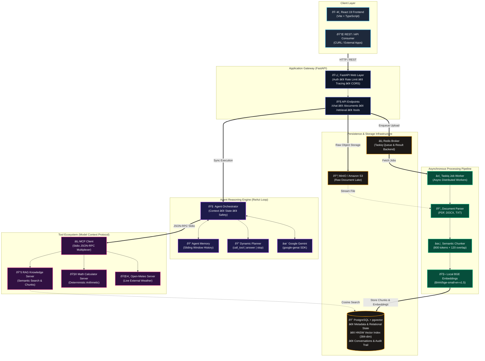
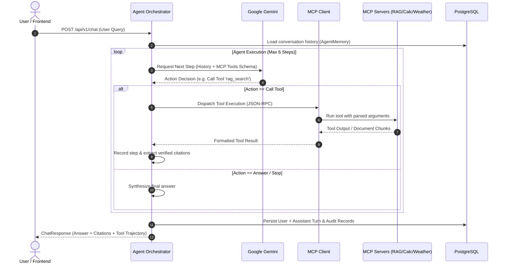
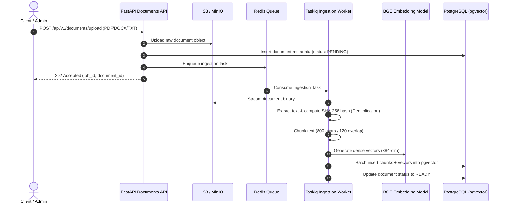

# Agentic RAG Platform

<p align="center">
  
  
  
  
  
  
  
</p>

An enterprise-grade, modular **Agentic Retrieval-Augmented Generation (RAG)** platform powered by autonomous reasoning, the **Model Context Protocol (MCP)**, asynchronous document ingestion, and verifiable citation attribution.

---

## System Architecture



---

## Core Execution Flows

### 1. Agentic ReAct Reasoning Loop



### 2. High-Throughput Ingestion & Vectorization



---

## Architectural Highlights

| Component | Technology | Responsibility |
| :--- | :--- | :--- |
| **Client UI** | React 19, Vite, TypeScript, Tailwind | Modern interactive UI with live chat streaming, citation previews, document status tracking, and MCP tool debugging. |
| **API Gateway** | FastAPI, Pydantic V2, Structlog | Async REST API enforcing authentication, request ID correlation, rate limiting, and structured error propagation. |
| **Reasoning Engine** | Google Gemini (`google-genai`), ReAct Pattern | Multi-turn reasoning agent with custom policies, step-budget safety guards, and explicit citation attribution. |
| **Tool Layer** | Model Context Protocol (MCP) | Decoupled tool servers executed via standardized stdio JSON-RPC protocol (`rag_server`, `calculator_server`, `weather_server`). |
| **Ingestion Pipeline** | Taskiq, Redis, PyTorch, PyPDF | Background ingestion worker capable of processing complex PDFs and documents without blocking user requests. |
| **Embeddings & Search** | BAAI/bge-small-en-v1.5, pgvector | Local, cost-effective 384-dimensional dense embeddings paired with PostgreSQL HNSW indexing for low-latency cosine retrieval. |
| **Object Lake** | MinIO / AWS S3 | Durable multi-tenant raw file storage with secure pre-signed URLs. |

---

## Quick Start

See **[RUN.md](RUN.md)** for the complete step-by-step installation and testing guide.

```bash
# 1. Environment Setup
cp .env.example .env
# Edit .env and insert your GEMINI_API_KEY

# 2. Launch Core Services (Docker)
docker compose up -d postgres redis minio

# 3. Setup Python Virtual Environment
pip install -r requirements.txt
alembic upgrade head
python scripts/download_embedding_model.py

# 4. Start the Application
python run_server.py           # Terminal 1: FastAPI API Gateway
python workers/run_worker.py   # Terminal 2: Taskiq Background Worker
```

- **Swagger Documentation:** [http://localhost:8000/docs](http://localhost:8000/docs)
- **Health Check:** [http://localhost:8000/api/v1/health](http://localhost:8000/api/v1/health)

---

## Frontend Web Application

A companion dashboard is included under `/frontend`:

```bash
cd frontend
npm install
npm run dev
```

Visit **[http://localhost:5173](http://localhost:5173)** to explore:
- 💬 **Interactive Agent Chat** with citation badges and tool execution trajectory.
- 📁 **Document Studio** with drag-and-drop upload and ingestion status tracking.
- 🔎 **Semantic Retrieval Search** to test vector similarity and inspect raw chunk hits.
- 🛠️ **MCP Tools Catalog** showing tool definitions, schema parameters, and real-time statuses.

---

## Implementation Roadmap

| Phase | Module | Details | Status |
| :---: | :--- | :--- | :---: |
| **1** | **Foundation** | FastAPI architecture, config management, DB session, health probes | ✅ Complete |
| **2** | **Document Management** | MinIO/S3 object storage, presigned URLs, document metadata | ✅ Complete |
| **3** | **Distributed Ingestion** | Taskiq worker, Redis broker, retry policies, task progress tracking | ✅ Complete |
| **4** | **Vector Search** | Local BGE embeddings, pgvector HNSW indexing, chunk deduplication | ✅ Complete |
| **5** | **Retrieval Subsystem** | Query rewriting, hybrid cosine retrieval, citation attribution | ✅ Complete |
| **6** | **LLM Integration** | Unified Gemini client (`google-genai`), structured response parsing | ✅ Complete |
| **7** | **MCP Tooling** | RAG, Calculator, and Open-Meteo Weather servers via JSON-RPC stdio | ✅ Complete |
| **8** | **Agent Orchestrator** | ReAct planning loop, sliding memory window, step limits | ✅ Complete |
| **9** | **Operations & Lifecycle** | Document deletion, chunk reindexing, retry management | ✅ Complete |
| **10** | **Frontend Application** | React 19 + TypeScript dashboard & chat interface | ✅ Complete |
